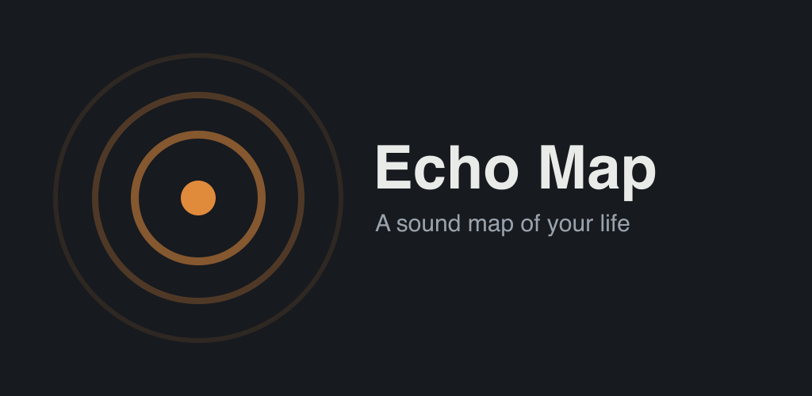

<div align="center">

<br />


<br /><br />

```
  ███████╗ ██████╗██╗  ██╗ ██████╗    ███╗   ███╗ █████╗ ██████╗
  ██╔════╝██╔════╝██║  ██║██╔═══██╗   ████╗ ████║██╔══██╗██╔══██╗
  █████╗  ██║     ███████║██║   ██║   ██╔████╔██║███████║██████╔╝
  ██╔══╝  ██║     ██╔══██║██║   ██║   ██║╚██╔╝██║██╔══██║██╔═══╝
  ███████╗╚██████╗██║  ██║╚██████╔╝   ██║ ╚═╝ ██║██║  ██║██║
  ╚══════╝ ╚═════╝╚═╝  ╚═╝ ╚═════╝    ╚═╝     ╚═╝╚═╝  ╚═╝╚═╝
```

### **A sound map of your life** — record a place, hear it again years later. Not photos. Sound.

[Live Demo](https://echo-map-seven.vercel.app) · [Report Bug](https://github.com/kutluhangil/EchoMap/issues) · [Request Feature](https://github.com/kutluhangil/EchoMap/issues)

<br />



</div>

---

## 🇹🇷 Türkçe Açıklama

**Echo Map**, hayatınızın bir ses haritasıdır. Anlamlı yerlerin kısa ortam seslerini kaydedip — bir kafenin uğultusu, sahildeki dalgalar, bir sokak çalgıcısı, çocuğunuzun kahkahası — yaşandıkları yere iliştirirsiniz. Yıllar sonra haritayı açar, parlayan bir pin'e dokunur ve tam o ana geri dönersiniz. Serin bir dünya, sıcak bir hafıza: harita sakin ve desatüre kalır, anılarınız sıcacık parlar. Her ses, gerçek kayda göre nabız atan halkalar yayar. Önce-cihaz çalışır — kayıtlarınız cihazınızda kalır, hesap gerekmez, konum yalnızca kayıt sırasında kullanılır. Tam İngilizce ve Türkçe.

---

## ✦ What is Echo Map?

**Echo Map** captures the short ambient sounds of the places that matter and pins them to where they happened. Open the map later, tap a glowing pin, and you're back in that exact moment — through sound, not a photo.

It's built around one bold motif: **sound rings**. Every recording radiates concentric ember rings that pulse to the real amplitude of the audio, so the recorder, the player, and the map all speak one quiet, distinctive language.

A cool world, a warm memory.

---

## ⚡ Features

| Feature                   | Description                                                                        |
| ------------------------- | ---------------------------------------------------------------------------------- |
| 🎙️ **One-Tap Recording**  | Live, sound-reactive rings and a scrubbable waveform driven by real audio metering |
| 🗺️ **Geotagged Pins**     | Each echo is auto-located and dropped on a custom slate Mapbox map                 |
| 🌍 **Opening 3D Globe**   | A React Three Fiber globe on launch, lit by the places you've been                 |
| 📜 **Nostalgic Timeline** | Echoes in reverse-chronological order — "three years ago" does the emotional work  |
| 🔊 **Sound Rings Motif**  | Skia-rendered concentric rings shared by the recorder, player, and map pins        |
| 🌓 **Light & Dark**       | A considered theme system, automatic or manual                                     |
| 🌐 **Bilingual (TR/EN)**  | Full English and Türkçe, following your system language with an override           |
| 🔒 **Local-First**        | Recordings live on your device — no account required, optional cloud backup        |
| ♿ **Accessible**         | Reduced-motion support, labelled controls, sensible contrast                       |

---

## 🖼️ Screenshots

<div align="center">

|                                                                     |                                                                            |
| :-----------------------------------------------------------------: | :------------------------------------------------------------------------: |
|       |        |
|            **Map** — every sound memory, on a slate map             |               **Recording** — live sound-ring record control               |
|  |  |
|                  **Timeline** — "three years ago"                   |               **Capture** — auto-located, feeling-first form               |

</div>

---

## 🛠️ Tech Stack

```
Frontend       →  React 19 · React Native 0.85 · Expo SDK 56 · TypeScript (strict) · Expo Router
Motion/Render  →  Reanimated 4 · React Native Skia (sound rings) · React Three Fiber (3D globe)
Map            →  Mapbox — @rnmapbox/maps (native) · mapbox-gl (web)
Audio          →  expo-audio — metered recording & waveform playback
Data           →  SQLite + Drizzle ORM · MMKV (settings) · Zustand (state)
i18n           →  i18next · react-i18next (TR / EN)
Cloud (opt-in) →  Supabase — Auth · Postgres · Storage (optional backup)
Deployment     →  EAS Build (Android) · Vercel (web build)
```

---

## 🚀 Getting Started

Echo Map relies on native modules (Mapbox, Skia, React Three Fiber / GL, audio, MMKV), so it runs in a [development build](https://docs.expo.dev/develop/development-builds/introduction/) — **not** Expo Go.

### Prerequisites

- Node.js `>= 18`
- **JDK 17 or 21** for the Android build (Gradle 9 doesn't support JDK 25)
- A free [Mapbox account](https://account.mapbox.com/access-tokens) for map tokens
- Android Studio / a connected device or emulator

### Local Development

```bash
# Clone the repository
git clone https://github.com/kutluhangil/EchoMap.git
cd EchoMap

# Install dependencies
npm install

# Configure environment
cp .env.example .env
# → add your Mapbox tokens (see below)

# Build, install, and start on a connected device/emulator
npm run android
```

> Without a Mapbox token the app still runs — the map simply shows a configuration notice.

### Environment Variables

| Variable                        | Description                                                               | Required |
| ------------------------------- | ------------------------------------------------------------------------- | :------: |
| `EXPO_PUBLIC_MAPBOX_TOKEN`      | Public Mapbox token (`pk.…`) — used at runtime by the map                 |    ✅    |
| `MAPBOX_DOWNLOAD_TOKEN`         | Secret download token (`sk.…`, `DOWNLOADS:READ`) — used only by EAS Build |    ✅    |
| `EXPO_PUBLIC_SUPABASE_URL`      | Supabase project URL — enables optional cloud backup                      |    ⬜    |
| `EXPO_PUBLIC_SUPABASE_ANON_KEY` | Supabase anon key — enables optional cloud backup                         |    ⬜    |

```env
EXPO_PUBLIC_MAPBOX_TOKEN=pk.your_public_token
MAPBOX_DOWNLOAD_TOKEN=sk.your_secret_token
# Optional — leave blank to stay fully local-first
EXPO_PUBLIC_SUPABASE_URL=
EXPO_PUBLIC_SUPABASE_ANON_KEY=
```

> Never commit `.env`. It's already in `.gitignore` — `EXPO_PUBLIC_` vars are bundled and readable on-device, so never put secrets behind that prefix.

`npm run db:generate` regenerates Drizzle migrations after a schema change.

---

## ☁️ Deployment

### Android — EAS Build

```bash
# Add the secret Mapbox token to EAS once
npx eas secret:create --name RNMAPBOX_MAPS_DOWNLOAD_TOKEN --value sk.your_secret --type string

# Build a release for the Play Store
npx eas build --platform android --profile production
```

Store and compliance material lives in [`docs/`](docs/) and [`store-assets/`](store-assets/) — launch checklist, privacy policy, data-safety, accessibility notes, and the TR + EN listing copy.

### Web — Vercel

A web build is exported via Expo and served on Vercel (mapbox-gl powers the map, `wa-sqlite` WASM powers storage).

```bash
npm run build:web      # expo export + WASM/config copy → dist/
npm run deploy:web     # build + vercel deploy --prod
```

---

## 📐 Project Structure

```
EchoMap/
├── app/                      # Expo Router screens
│   ├── index.tsx             # Opening globe → onboarding / map
│   ├── onboarding.tsx
│   ├── (tabs)/               # Map · Timeline
│   └── echo/                 # new.tsx (capture) · [id].tsx (detail)
├── components/
│   ├── audio/                # Recorder · Player · Waveform · AmplitudeRings
│   ├── globe/                # OpeningGlobe (R3F) · shaders · geo
│   ├── map/                  # EchoMap · PinCluster · SoundRingPin
│   ├── motion/               # FadeIn · SharedElement
│   ├── providers/            # AppProviders · DatabaseProvider
│   └── ui/                   # Button · Field · Sheet · Text · …
├── lib/
│   ├── audio/                # recorder · player · waveform · amplitude
│   ├── db/                   # Drizzle schema · client · migrations
│   ├── location/             # geo · reverse-geocode
│   ├── storage/              # files · kv (MMKV) · export
│   ├── sync/                 # Supabase auth · sync engine (opt-in)
│   └── i18n/ · utils/
├── store/                    # Zustand stores (echo · audio · settings · sync)
├── theme/                    # colors · typography · spacing · ThemeProvider
├── locales/                  # en.json · tr.json (kept key-for-key in sync)
└── docs/ · store-assets/     # launch & compliance material
```

---

## 🔌 Core Modules

| Module                                    | Purpose                                                                   |
| ----------------------------------------- | ------------------------------------------------------------------------- |
| **`components/audio/AmplitudeRings.tsx`** | The signature element — Skia rings driven by a Reanimated amplitude value |
| **`lib/audio/recorder.ts`**               | Metered `expo-audio` recording (≤ 60s ambient clips, AAC/m4a)             |
| **`lib/audio/waveform.ts`**               | Downsampled bars stored as a sidecar JSON, with a session in-memory cache |
| **`store/useEchoStore.ts`**               | Source of truth for echoes — keeps SQLite, audio files, and UI consistent |
| **`components/map/PinCluster.tsx`**       | GeoJSON clustering — stays smooth with hundreds of ember pins             |
| **`lib/db/schema.ts`**                    | Drizzle schema + migrations for the local SQLite store                    |

---

## 📊 How It Works

### Sound Rings

A single Reanimated `SharedValue` carries live amplitude (0..1) from the recorder's metering or the player's waveform position. Skia subscribes to it and redraws three concentric ember circles every frame — so the rings pulse to the actual sound, on the UI thread, without re-rendering React.

### Local-First Data

Every echo is one SQLite row (Drizzle) plus two files in the app sandbox: the `.m4a` recording and a `.waveform.json` sidecar. The recording is moved into the sandbox **before** the row is written, so a row never points at a missing file. Nothing leaves the device unless cloud backup is explicitly turned on.

### Privacy Model

Recordings stay local by default. No account is required. Location is read **only while recording** — background location is deliberately never requested, keeping the app clear of Google Play's strict review. Optional Supabase backup is opt-in and protected by row-level security.

---

## 🗺️ Roadmap

| Status | Feature                                            |
| :----: | -------------------------------------------------- |
|   ✅   | One-tap recording with live sound rings            |
|   ✅   | Geotagged pins on a custom slate map               |
|   ✅   | Opening 3D globe (React Three Fiber)               |
|   ✅   | Nostalgic timeline with relative ages              |
|   ✅   | Light/dark themes · TR/EN · reduced-motion         |
|   ✅   | Local-first SQLite storage + export                |
|   ✅   | Cinematic web demo with live data                  |
|   🔄   | Optional Supabase cloud backup & multi-device sync |
|   🔄   | Google Play release                                |
|   ○    | iOS release                                        |
|   ○    | Shared / collaborative sound maps                  |
|   ○    | On-device sound classification (suggested titles)  |

<sub>✅ Shipped &nbsp; · &nbsp; 🔄 In progress &nbsp; · &nbsp; ○ Planned</sub>

---

## 🤝 Contributing

Contributions are welcome.

1. Fork the repository
2. Create your feature branch (`git checkout -b feature/amazing-feature`)
3. Commit your changes (`git commit -m 'feat: add amazing feature'`)
4. Push to the branch (`git push origin feature/amazing-feature`)
5. Open a Pull Request

Lint and types are enforced: `npm run lint` and `npm run typecheck` (a Husky pre-commit hook runs both).

---

## 📄 License

Distributed under the **MIT License**. See [`LICENSE`](LICENSE) for details.

---

<div align="center">

<br />

Built with ❤️ by [**Kutluhan Gil**](https://github.com/kutluhangil)

<br />

_If this made you want to record a moment, consider leaving a ⭐_

<br />

</div>
