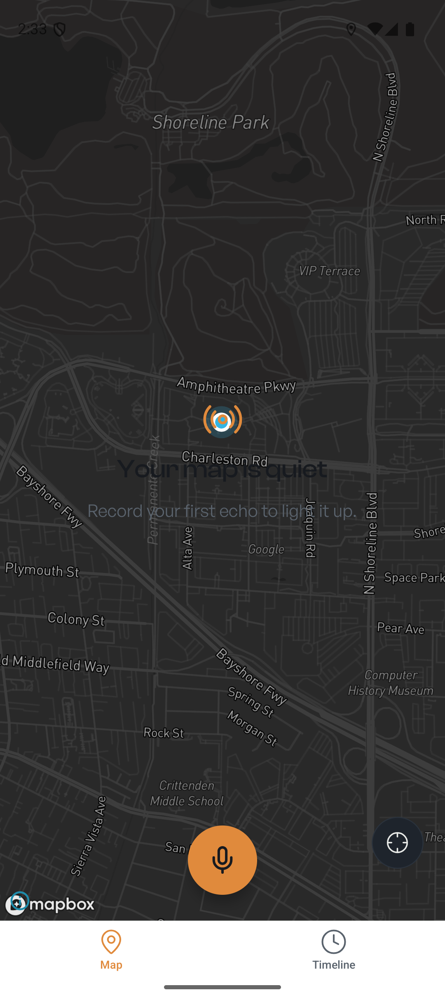
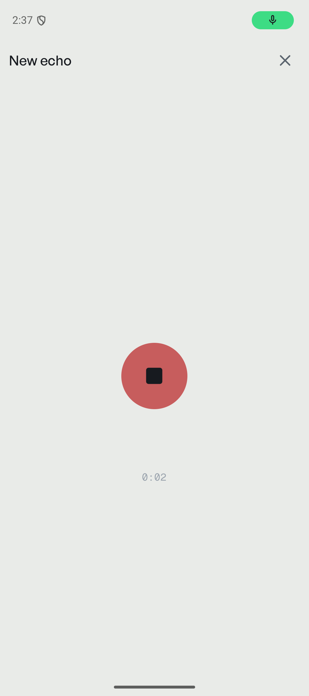
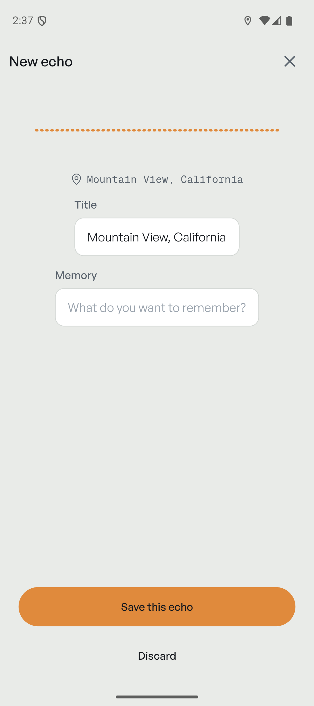
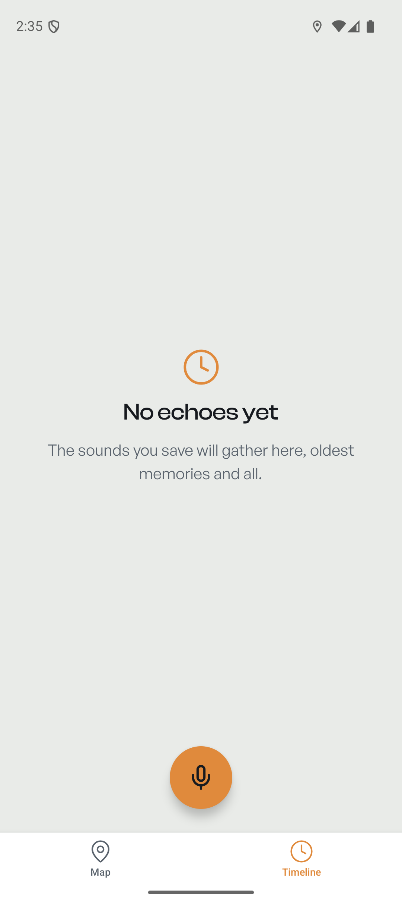
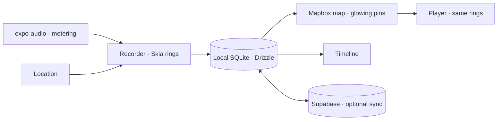

<div align="center">



<p>
  
  
  
  
</p>

<p><em>Capture the short ambient sounds of the places that matter and pin them where they happened.<br>
Open the map years later, tap a glowing pin, and you are back in that moment. Not photos. Sound.</em></p>

<table>
  <tr>
    <td width="25%"></td>
    <td width="25%"></td>
    <td width="25%"></td>
    <td width="25%"></td>
  </tr>
</table>

</div>


## What it is

A café's murmur, waves on the shore, a street musician, your child's laugh. Echo Map is built around one motif: **sound rings**. Every recording radiates concentric ember rings that pulse to the real amplitude of the audio, so the recorder, the player and the map pins all speak the same language. A cool world, a warm memory.

| | |
|---|---|
| **One-tap recording** | Live, sound-reactive rings and a scrubbable waveform driven by real metering. |
| **Geotagged pins** | Each echo is located automatically and dropped on a custom slate Mapbox map. |
| **Opening globe** | A React Three Fiber globe on launch, lit by the places you have been. |
| **Nostalgic timeline** | Echoes in reverse order, where "three years ago" does the emotional work. |
| **Sound rings** | Skia-rendered rings shared by the recorder, the player and the pins. |
| **Light and dark** | A considered theme system, automatic or manual. |


## How it fits together




## Türkçe özet

**Echo Map**, hayatının bir ses haritası. Anlamlı yerlerin kısa ortam seslerini (bir kafenin uğultusu, sahildeki dalgalar, bir sokak çalgıcısı, çocuğunun kahkahası) kaydedip yaşandığı yere iğneliyorsun. Yıllar sonra haritadaki parlayan iğneye dokununca o ana fotoğrafla değil sesle dönüyorsun. Kayıt, oynatıcı ve harita iğneleri sesin gerçek şiddetine göre atan halkalarla aynı görsel dili paylaşıyor. Expo ile yazılmış bir mobil uygulama.


## Development

```sh
npm install
cp .env.example .env         # Mapbox token, optional Supabase
npx expo start
npm run typecheck
npm run db:generate          # Drizzle migrations
```

```
app/          expo-router screens: onboarding, tabs, echo detail
components/   recorder, rings, map, timeline, globe
store-assets/ store screenshots
```

<div align="center">
<br>
<a href="https://github.com/kutluhangil"></a>
<sub>A cool world, a warm memory.</sub>
</div>
